

  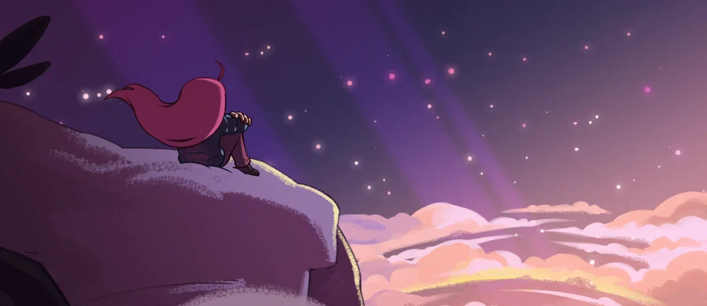
     
  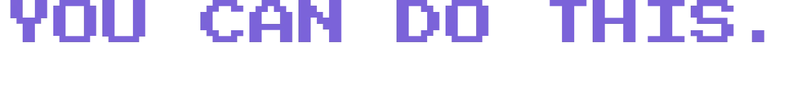
   
  
  
  
    
  
  

    <strong>Building</strong>: an AI diary for Celeste 
    <strong>Studying</strong>: software engineering, third year 
    <strong>Running</strong>: ten kilometers every morning
  

   
  

    <a href="#about">About</a> · <a href="#stack">Stack</a> · <a href="#chapters">Chapters</a> · <a href="#projects">Projects</a> · <a href="#letters">Say hi</a>
  

## <picture><source media="(prefers-color-scheme: dark)" srcset="./assets/headings/about-dark.webp">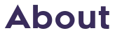</picture>

I'm a third-year software engineering student at Taiyuan University of Technology.

Most of what's on this account is code I wrote because I wanted to understand something. The Celeste diary is the current one — a blog, an assistant, and a lot of pixel art around it.

  

  <picture>
    <source media="(prefers-color-scheme: dark)" srcset="./assets/divider-dark.webp" />
    <source media="(prefers-color-scheme: light)" srcset="./assets/divider-light.webp" />
    
  </picture>

### <picture><source media="(prefers-color-scheme: dark)" srcset="./assets/icons/reflection-dark.webp">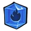</picture> <picture><source media="(prefers-color-scheme: dark)" srcset="./assets/headings/celeste-dark.webp"></picture>

Main story finished. Still missing the golden strawberries. I record some TAS runs, and the diary app is built around the game.

  <picture>
    <source media="(prefers-color-scheme: dark)" srcset="./assets/divider-dark.webp" />
    <source media="(prefers-color-scheme: light)" srcset="./assets/divider-light.webp" />
    
  </picture>

### <picture><source media="(prefers-color-scheme: dark)" srcset="./assets/icons/core-dark.webp"></picture> <picture><source media="(prefers-color-scheme: dark)" srcset="./assets/headings/stack-dark.webp"></picture>

<table style="font-family:'Renogare','CelesteZH',sans-serif;font-size:16px;line-height:1.7">
<tr><td>Languages</td><td>Java, Python, JavaScript, SQL</td></tr>
<tr><td>Backend</td><td>Spring Boot 3.2, MyBatis-Plus, JWT</td></tr>
<tr><td>Data</td><td>MySQL, Redis</td></tr>
<tr><td>Frontend</td><td>Handwritten HTML/CSS/JS — no framework, no build step</td></tr>
<tr><td>AI</td><td>Qwen2.5-7B for chat, bge-m3 for embeddings, through SiliconFlow</td></tr>
<tr><td>Ops</td><td>Docker, Prometheus</td></tr>
</table>

Going deeper on three things right now: machine learning from scratch with NumPy, frontend without frameworks, and LLM applications. The diary is where the last one gets tested.

  <picture>
    <source media="(prefers-color-scheme: dark)" srcset="./assets/divider-dark.webp" />
    <source media="(prefers-color-scheme: light)" srcset="./assets/divider-light.webp" />
    
  </picture>

### <picture><source media="(prefers-color-scheme: dark)" srcset="./assets/icons/intro-dark.webp"></picture> <picture><source media="(prefers-color-scheme: dark)" srcset="./assets/headings/how-i-got-here-dark.webp"></picture>

The last few years, arranged as game chapters. Nine in the game; I used eight — the one I left out hasn't happened yet.

  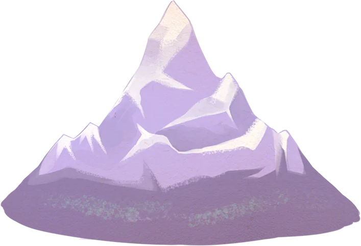

<table style="font-family:'Renogare','CelesteZH',sans-serif;font-size:16px;line-height:1.7">
<tr><td>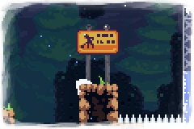</td><td><strong>Forsaken City</strong></td><td>First time travelling alone.</td></tr>
<tr><td>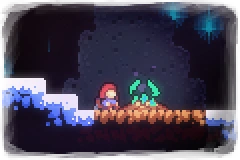</td><td><strong>Old Site</strong></td><td>Things I thought were finished were still waiting where I left them.</td></tr>
<tr><td>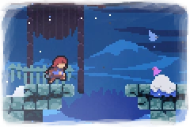</td><td><strong>Celestial Resort</strong></td><td>Cleaning up a mess nobody else wanted.</td></tr>
<tr><td></td><td><strong>Golden Ridge</strong></td><td>Headwind the whole way.</td></tr>
<tr><td>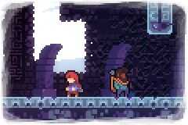</td><td><strong>Mirror Temple</strong></td><td>The part of me I'd rather not look at.</td></tr>
<tr><td></td><td><strong>Reflection</strong></td><td>Deciding whether to keep going.</td></tr>
<tr><td></td><td><strong>The Summit</strong></td><td>Ten kilometers done, the sun is up.</td></tr>
<tr><td>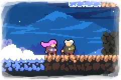</td><td><strong>Farewell</strong></td><td>Not yet. Saving it for later.</td></tr>
</table>

  <picture>
    <source media="(prefers-color-scheme: dark)" srcset="./assets/divider-dark.webp" />
    <source media="(prefers-color-scheme: light)" srcset="./assets/divider-light.webp" />
    
  </picture>

### <picture><source media="(prefers-color-scheme: dark)" srcset="./assets/icons/cassette-dark.webp"></picture> <picture><source media="(prefers-color-scheme: dark)" srcset="./assets/headings/projects-dark.webp"></picture>

Four repositories. Mostly things I built to learn something, all finished enough to run.

Open the list

<table style="font-family:'Renogare','CelesteZH',sans-serif;font-size:16px;line-height:1.7">
<tr><th>Project</th><th>What it is</th><th>Stack</th></tr>
<tr><td>[Celeste-AI-Diary-Companion-Blog](https://github.com/melinhades/Celeste-AI-Diary-Companion-Blog)</td><td>Blog, AI diary companion and Celeste UI</td><td>Spring Boot, plain JS, MySQL</td></tr>
<tr><td>[robolings](https://github.com/melinhades/robolings)</td><td>Machine learning exercises</td><td>Python, NumPy</td></tr>
<tr><td>[Weave](https://github.com/melinhades/Weave)</td><td>A service development platform</td><td>Java</td></tr>
<tr><td>[CelesteTAS](https://github.com/melinhades/CelesteTAS)</td><td>Tool-assisted speedrun recordings</td><td>Celeste</td></tr>
</table>

  Contribution history
   
  

  <picture>
    <source media="(prefers-color-scheme: dark)" srcset="./assets/divider-dark.webp" />
    <source media="(prefers-color-scheme: light)" srcset="./assets/divider-light.webp" />
    
  </picture>

### <picture><source media="(prefers-color-scheme: dark)" srcset="./assets/icons/checkpoint-dark.webp"></picture> <picture><source media="(prefers-color-scheme: dark)" srcset="./assets/headings/a-day-dark.webp"></picture>

Open the timeline

<table style="font-family:'Renogare','CelesteZH',sans-serif;font-size:16px;line-height:1.7">
<tr><th>Time</th><th>What</th></tr>
<tr><td>Before dawn</td><td>Ten kilometers. Then the day can start.</td></tr>
<tr><td>Daytime</td><td>Classes, coursework, the occasional staring into space</td></tr>
<tr><td>Evening</td><td>Reading and code. Often stuck in the same place for hours.</td></tr>
<tr><td>Late night</td><td>A couple of Celeste levels, or writing something nobody reads.</td></tr>
</table>

  <picture>
    <source media="(prefers-color-scheme: dark)" srcset="./assets/divider-dark.webp" />
    <source media="(prefers-color-scheme: light)" srcset="./assets/divider-light.webp" />
    
  </picture>

### <picture><source media="(prefers-color-scheme: dark)" srcset="./assets/icons/farewell-dark.webp">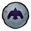</picture> <picture><source media="(prefers-color-scheme: dark)" srcset="./assets/headings/whats-next-dark.webp"></picture>

Open the list

<ul style="font-family:'Renogare','CelesteZH',sans-serif;font-size:17px;line-height:1.75">
<li>Turn the machine learning exercises into notes that actually run</li>
<li>Build one complete application from scratch, no framework</li>
<li>Make the diary solid instead of big</li>
</ul>

  <picture>
    <source media="(prefers-color-scheme: dark)" srcset="./assets/divider-dark.webp" />
    <source media="(prefers-color-scheme: light)" srcset="./assets/divider-light.webp" />
    
  </picture>

### <picture><source media="(prefers-color-scheme: dark)" srcset="./assets/icons/heart-dark.webp"></picture> <picture><source media="(prefers-color-scheme: dark)" srcset="./assets/headings/say-hi-dark.webp"></picture>

  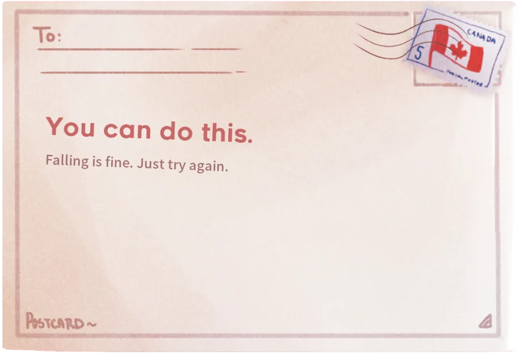

If any of this is close to what you're working on, email is the fastest way to reach me.

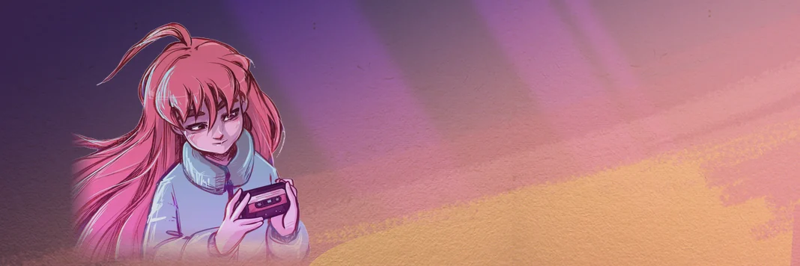

 

Contact: <a href="mailto:jfy2846484252@outlook.com">jfy2846484252@outlook.com</a> · <a href="#top">Back to top</a>

 

Pixel art from <a href="https://www.celestegame.com/">Celeste</a> © Maddy Makes Games, used for a personal page.

<!--
Contribution snake: enable once .github/workflows/snake.yml has run successfully.
Before the first run the links 404 and show broken images, which is why this stays
commented out. Remove the comment markers below to turn it on.

  <picture>
    <source media="(prefers-color-scheme: dark)" srcset="https://raw.githubusercontent.com/melinhades/melinhades/output/snake-dark.svg" />
    <source media="(prefers-color-scheme: light)" srcset="https://raw.githubusercontent.com/melinhades/melinhades/output/snake.svg" />
    
  </picture>

-->
