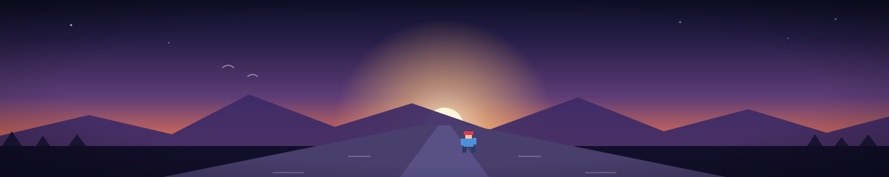

         

Who I am
I am a software engineering student at Taiyuan University of Technology.

My work is shaped by two habits that have become more than routines: a daily 10 km run before sunrise, and the way Celeste treats difficulty not as an obstacle to erase, but as something to keep carrying upward.

This page is not a résumé. It is a record of how I learn, build, and keep going when the work is slow and uncertain.

Why Celeste and running matter
Celeste taught me that the hardest part is rarely the mechanics. It is the repeated decision to keep trying, to carry the part of yourself that says “you can’t” and still move forward.

Running gives that lesson a body. Each morning, before the city wakes up, I run a distance that offers no reward except the fact that I finished it. No screenshots, no applause, no validation. Just repetition, and the calm that comes from doing the thing that is hard but real.

I do not see this as a personality trait. I see it as a method:

repeat without drama
keep the standard honest
do the unglamorous work before the obvious work
treat setbacks as data, not identity
That is the same approach I try to bring to software engineering.

What I build
I am interested in engineering that is understandable, durable, and useful. I like building systems where the logic is visible, the trade-offs are clear, and the work can be improved without pretending it was never messy.

My technical direction is broad but grounded:

Frontend: user experience, browser logic, interface clarity, interactions that feel intentional
Backend: APIs, data flow, auth, persistence, service design, real-world constraints
AI applications: memory, retrieval, emotion-aware interaction, prompt design, evaluation loops
Learning style: start from fundamentals, build without shortcuts, validate with real usage
I am not interested in chasing trends just because they are popular. I am more interested in learning how things actually work, and being able to explain why they work.

Real projects
melinhades/Celeste-AI-Diary-Companion-Blog
This is the clearest example of how I think and build.

It is a full-stack blog and AI diary companion inspired by Celeste’s emotional and reflective atmosphere. The project is not built around a single clever feature; it is built around a system that tries to balance personal expression, AI assistance, memory, and user experience.

The stack is deliberately practical:

Backend: Java + Spring Boot + MyBatis-Plus + MySQL + Redis
Frontend: vanilla HTML/CSS/JS
AI: retrieval, prompt design, conversation memory, emotion-aware processing
Architecture: service-oriented, real data flow, clear separation of concerns
What I value here is not just “AI features.” It is the process:

building the data layer before the flash
making the interaction feel natural without hiding the complexity
treating the model as one part of a system, not magic
validating outputs instead of trusting the illusion of intelligence
This project reflects the way I try to work: make things real, keep them understandable, and improve them through iteration.

melinhades/melinhades
This repository is my personal profile and a place to hold the public, visible version of my thinking.

It is less about spectacle and more about clarity:

who I am
what I value
what I build
how I keep learning

Growth trajectory
I am still early in the path, and I prefer that to be honest.

Currently, I am learning in a way that emphasizes depth over surface:

machine learning and AI fundamentals, implemented from scratch where possible
frontend fundamentals before framework abstraction
backend patterns and system design through real projects
consistency in the boring work that compounds over time
This is not a “look at my polished project” portfolio. It is a working record of someone learning by doing.

Area	How I approach it	Status
AI / LLM	Understand mechanisms, not just demos	Ongoing
Frontend	Vanilla first, then abstraction	Ongoing
Backend	Learn through real systems and APIs	Ongoing
Learning	Build small but meaningful things	Continuous
Running	10 km before sunrise, every day	Habit
What matters to me is not how many things I can say I know. It is whether I can keep learning with structure and integrity.

What I value in engineering
I care about a few things more than hype:

clarity over cleverness
repeatability over improvisation
proof over intuition
durable systems over temporary polish
honest constraints over fake confidence
That mindset is shaped by both software work and the personal habits I keep outside of it. A lot of what I do is about learning to keep going when the task is not interesting, when the problem is not elegant, and when the result is not visible yet.

I believe that is where real engineering begins.

Contact
If you are interested in conversations about software engineering, AI product work, thoughtful frontend/backend building, or the kind of personal projects that are shaped by discipline and curiosity, I’m always open to talking.

📮 jfy2846484252@outlook.com

 
 <i>The mountain is there. I keep climbing.</i> 

